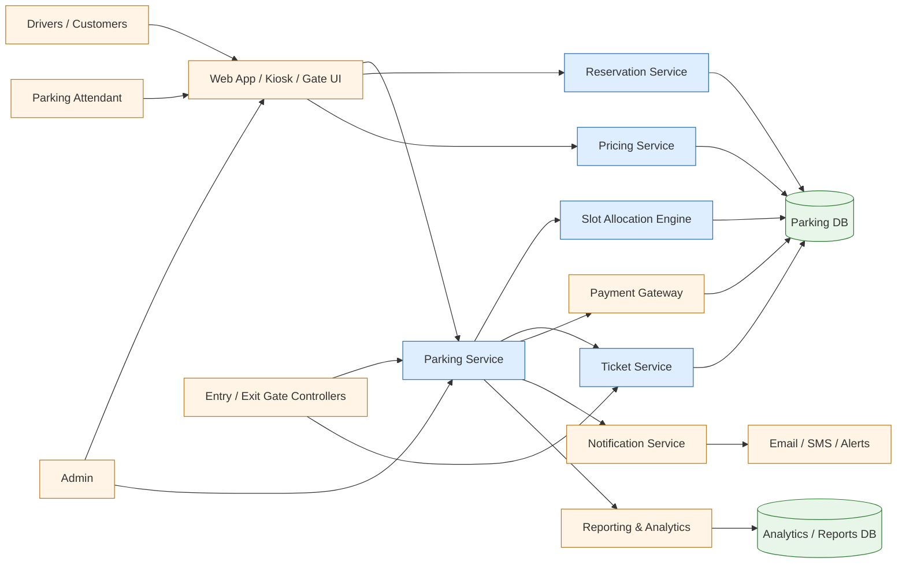

# Parking Lot Management System

## 1. Overview

The Parking Lot Management System is a software solution designed to manage vehicle parking efficiently in a controlled environment. It automates the entire parking lifecycle, including slot assignment, ticket generation, payment calculation, occupancy tracking, and entry/exit processing. It is intended for use in malls, office campuses, hospitals, airports, apartment complexes, and city parking facilities where efficient space utilization and smooth vehicle flow are essential.

The system helps reduce manual effort, minimize queue times, avoid slot conflicts, maintain accurate billing records, and improve operational visibility for parking administrators and attendants.

## 2. Use Case

### Business Problem
Managing a parking lot manually often leads to:
- long queues at entry and exit gates
- incorrect vehicle-to-slot assignments
- poor visibility into occupancy
- inaccurate or inconsistent billing
- lack of reports for revenue and utilization
- difficulty enforcing different vehicle-type rules
- poor control over premium or reserved slots

### Solution Provided by the System
The system manages a parking lot automatically and centrally. It records each vehicle as it enters, assigns a valid slot based on availability and vehicle category, tracks the parking duration, applies pricing rules, processes payment on exit, and frees the slot for future use.

### Main Actors
- Driver / Customer
- Parking Attendant
- Parking Administrator
- Security Manager
- Finance / Billing Team
- System Admin

### Typical Scenarios
1. A vehicle enters the parking facility.
2. The system checks the lot status and slot availability.
3. It allocates a valid slot based on vehicle type and policies.
4. A ticket or token is generated and stored.
5. The vehicle parks until departure.
6. On exit, the system calculates duration and fee.
7. Payment is processed.
8. The system frees the slot and updates dashboards and reports.

## 3. Functional Requirements

### FR1: Parking Lot Configuration
The system shall allow an admin to configure:
- parking lot name and location
- number of floors/levels
- total number of parking slots
- slot categories such as regular, compact, premium, EV, VIP, and handicapped
- entry and exit gates
- pricing rules per vehicle type and time duration

### FR2: Slot Management
The system shall support:
- adding and removing slots
- marking a slot as available/occupied/reserved/maintenance
- assigning slots to compatible vehicle types
- preventing duplicate allocation of the same slot

### FR3: Vehicle Entry
When a vehicle enters:
- the system shall validate the ticket or token process
- check if the facility has free capacity
- assign a compatible slot
- generate a unique parking ticket
- store entry timestamp, gate, and slot details
- display assignment details to the attendant

### FR4: Vehicle Exit
When a vehicle leaves:
- the system shall locate the active ticket
- calculate parking duration
- apply pricing according to the rules
- accept payment
- validate the payment and close the session
- free the slot
- log the exit transaction

### FR5: Ticketing System
The system should support:
- unique ticket generation
- ticket lookup by ticket ID or vehicle registration number
- ticket cancellation or invalidation in special scenarios
- lost ticket support via manual intervention

### FR6: Pricing Rules
The system shall support configurable pricing schemes such as:
- hourly charges
- daily flat rate
- weekly or monthly passes
- premium slot fees
- EV charging fees
- discount rules for members
- late fee or overstay charges

### FR7: Vehicle Categories
The system shall support multiple vehicle types, including:
- car
- motorcycle
- scooter
- truck
- bus
- electric vehicle
- disabled-access vehicle
- VIP vehicle

### FR8: Reservation Support
The system may allow admins or users to reserve parking space for:
- monthly subscriptions
- special events
- premium customers
- corporate users

Reservations must not conflict with active bookings.

### FR9: Full Lot Behavior
When the parking lot is full, the system shall:
- inform the attendant or gate system
- display a “full” status
- reject new entries when no compatible slot is available
- allow admin override in exceptional situations if configured

### FR10: Dashboard and Real-Time Monitoring
The system shall provide a dashboard showing:
- total capacity
- available slots
- occupied slots
- reserved slots
- current vehicle count
- occupancy percentage
- zone-wise capacity usage
- real-time entry and exit logs

### FR11: Reporting
The system shall generate reports such as:
- total revenue per day
- hourly occupancy trends
- peak usage times
- vehicle category distribution
- revenue by parking zone
- utilization by slot type
- payment summary by method

### FR12: User Roles and Security
The system shall support roles like:
- admin
- operator
- security staff
- finance user
- system administrator

Each role shall have defined permissions for operations and data access.

### FR13: Notifications and Alerts
The system should send alerts for:
- parking full status
- overstay vehicles
- invalid payment or failed transaction
- maintenance in a specific zone
- reservation expiration
- suspicious activity or operational issues

### FR14: Payment Support
The system shall support:
- cash payment
- card payment
- wallet / UPI payment
- prepaid membership payment
- invoice generation for corporate or recurring accounts

### FR15: Error Handling and Validation
The system shall validate:
- duplicate ticket creation
- invalid vehicle entry or missing record on exit
- invalid payment amount
- assignment of a slot already occupied
- unauthorized vehicle movement or gate access
- missing admin authorization for overrides

### FR16: Audit Logging
The system shall record:
- entry/exit events
- slot assignment changes
- pricing modifications
- payment transactions
- admin actions
- exceptions and overrides

### FR17: Multi-Gate and Multi-Level Support
The system shall support:
- multiple entry gates
- multiple exit gates
- multiple floors/levels
- multiple zones
- parallel processing without inconsistent slot states

### FR18: Maintenance and Rebooking
Admins should be able to:
- mark slots as under maintenance
- reopen closed slots
- update pricing policies
- reassign slot categories
- handle temporary closures for repairs or events

## 4. High-Level Architecture

### 4.1 Architecture Overview
The Parking Lot system can be modeled as a layered, event-driven architecture built around a central parking management service. The main components are:

- Client / Gate Interface: entry kiosks, exit terminals, admin dashboard, and operator screens
- Application Layer: parking service, pricing service, ticket service, payment service, reservation service, and report service
- Domain Layer: ParkingLot, ParkingFloor, ParkingSlot, Vehicle, Ticket, Payment, Reservation, and PricingPolicy
- Persistence Layer: database storing slot states, tickets, transactions, and audit logs
- Integration Layer: payment gateway, gate controller, notification services, and analytics/reporting components
- Monitoring Layer: logs, metrics, alerts, and dashboards for operational visibility

### 4.1.1 High-Level Design Diagram

This diagram shows the core flow: vehicle and staff actions pass through the UI and gate controllers into the parking management services, which interact with the slot, ticket, pricing, reservation, and payment components. The system updates persistent data and sends notifications and reports to operations teams.

### 4.2 Core Components

#### 1. Entry Gate Service
Responsible for vehicle ingress validation and ticket issuance. It checks lot capacity, finds an appropriate slot, and triggers the creation of a new parking session.

#### 2. Exit Gate Service
Handles vehicle departures by reading the active ticket, calculating stay duration, applying pricing rules, processing payment, and releasing the slot.

#### 3. ParkingLot Service
Maintains the overall state of the lot, including occupancy, zone availability, and slot assignments. This is the central orchestration layer for slot allocation and release.

#### 4. Slot Allocation Engine
Selects the best available slot based on vehicle category, zone preference, reservation status, and maintenance state.

#### 5. Pricing Service
Computes parking charges based on:
- vehicle type
- time duration
- slot category
- discounts or membership plans
- special service charges
- penalties for overstay

#### 6. Payment Service
Integrates with cash, card, wallet, or third-party payment systems. It validates the transaction and updates the ticket state.

#### 7. Reservation Service
Manages advance bookings and recurring membership parking so the allocator can take reserved spaces into account.

#### 8. Notification Service
Sends internal or external alerts for lot-full scenarios, overstay detection, failed payment, maintenance updates, or reservation reminders.

#### 9. Reporting & Analytics Service
Collects data from all parking sessions and generates dashboards, occupancy trends, and financial reports.

#### 10. Audit and Security Layer
Tracks changes to pricing, slot states, ticket adjustments, and admin operations to support compliance and operational reviews.

### 4.3 High-Level Interaction Flow

1. A Vehicle reaches the Entry Gate.
2. The Entry Gate calls the ParkingLot Service.
3. The system checks slot availability and compatibility.
4. A ParkingSlot is assigned.
5. A Ticket is created and stored.
6. The ticket is linked to the vehicle and slot.
7. The vehicle parks until exit.
8. The Exit Gate requests close-out for the ticket.
9. The Pricing Service calculates the total charge.
10. The Payment Service processes the fee.
11. The slot is released and marked available.
12. Reports and dashboards are updated.

### 4.4 System Components and Responsibilities

- Gate Interface: accepts vehicle entry/exit requests
- Parking Management Service: orchestrates slot assignment and exit processing
- Slot Repository: stores the real-time state of every slot
- Ticket Repository: stores entry, exit, and session history
- Pricing Engine: enforces dynamic pricing policies
- Payment Gateway: handles external payments
- Notification Module: alerts staff and users
- Analytics Layer: reports occupancy and revenue metrics

### 4.5 Design Principles
The design should follow these principles:

- Single responsibility: each service handles one operational concern
- Real-time consistency: slot availability and ticket state must always match
- Fault tolerance: failure of one service must not corrupt the parking state
- Extensibility: support future features like EV charging, license plate recognition, and mobile reservation
- Security-first: roles, access controls, and audit logs must be enforced
- Scalability: support more gates, users, and lots without redesigning the core logic

### 4.6 Recommended Technology View
A practical implementation can use:

- Frontend: React / Angular / simple admin portal
- Backend: Java Spring Boot / Node.js / .NET
- Database: PostgreSQL or MySQL for transactional data
- Cache: Redis for real-time slot state and frequently accessed data
- Messaging: Kafka or RabbitMQ for event-based notifications and logging
- Monitoring: Prometheus + Grafana or equivalent tools
- Authentication: JWT / Role-based access control

### 4.7 Data Model (Conceptual)
The high-level model includes:

- ParkingLot
  - id
  - name
  - location
  - totalCapacity
  - floors
  - activeStatus

- ParkingFloor
  - id
  - lotId
  - floorNumber
  - slotList

- ParkingSlot
  - id
  - floorId
  - slotNumber
  - category
  - status
  - assignedVehicleId

- Vehicle
  - id
  - registrationNumber
  - type
  - ownerInfo

- Ticket
  - id
  - vehicleId
  - entryTime
  - exitTime
  - slotId
  - gateId
  - status
  - totalAmount

- Payment
  - id
  - ticketId
  - amount
  - method
  - status
  - timestamp

- Reservation
  - id
  - vehicleId
  - slotId
  - startTime
  - endTime
  - status

### 4.8 Scalability Considerations
For larger systems, the architecture can be expanded with:

- distributed service instances for entry and exit operations
- database partitioning by lot or region
- read replicas for reports and dashboard queries
- event streaming for occupancy and notification updates
- asynchronous processing for billing analytics and historical data aggregation

### 4.9 Risks and Constraints
- Race conditions while assigning slots under concurrent requests
- Duplicate ticket generation during outages or retries
- Payment inconsistencies between external gateway failure and ticket closure
- Delay in real-time dashboard updates for high-throughput lots

These are addressed through idempotency, transaction boundaries, locking strategies, and event-driven workflows.

## 5. Non-Functional Requirements

### NFR1: Performance
The system must handle vehicle entry and exit efficiently, even during peak hours. The response time for checking slot availability and processing ticket generation should be low and predictable.

### NFR2: Scalability
The system should be able to support growth in:
- number of parking lots
- entries and exits per hour
- number of users
- number of slots
- reporting volume

### NFR3: Availability
The system should be available during operating hours with minimal downtime. Critical functions like entry, exit, and payment processing must remain reliable.

### NFR4: Reliability
The system must avoid data inconsistency such as:
- double assignment of the same slot
- payment recorded without ticket closure
- ticket issued without a valid slot
- incorrect slot availability count

### NFR5: Security
The system must protect sensitive data including:
- vehicle numbers
- payment data
- admin credentials
- operational logs

It should support encryption, access control, and secure user authentication.

### NFR6: Data Integrity
The system must maintain consistent records across ticketing, slot status, payments, and audit logs.

### NFR7: Maintainability
The code and architecture should be modular so newer features such as automated plate recognition, digital ticketing, or EV charging integration can be added without major redesign.

### NFR8: Usability
The interface should be simple and easy to navigate for attendants and admins. It should minimize the learning curve and improve operator efficiency.

### NFR9: Observability
The system must log major events for traceability, such as entry, exit, pricing updates, payment failures, and manual overrides.

### NFR10: Compliance
The system must handle customer and vehicle data responsibly and securely according to applicable data protection and privacy regulations.

### NFR11: Auditability
Each important action should be logged with timestamps and operator identity so that activities can be reviewed later.

### NFR12: Interoperability
The system should be able to integrate with:
- payment gateways
- external gate controllers
- CCTV and surveillance systems
- vehicle recognition systems
- mobile or web apps

## 5. Assumptions
- The facility may have one or multiple parking levels.
- Each slot belongs to a category and supports certain vehicle types.
- One vehicle can occupy only one slot at a time.
- Payment may be collected at the time of exit or via an account-based system.
- Not all parking lots will have the same pricing model.
- Manual override may be needed in exceptional cases.

## 6. Constraints
- Slot allocation must be accurate and thread-safe for simultaneous operations.
- Data must remain consistent even under peak load.
- Payment and slot release should not become inconsistent.
- The system may need to support both digital and manual workflows.

## 7. Functional User Stories

### Admin
- As an admin, I want to configure parking zones and pricing so that capacity and revenue are managed correctly.
- As an admin, I want to view occupancy and revenue reports so that business decisions can be made.
- As an admin, I want to mark slots under maintenance so that the facility remains organized.

### Attendant
- As an attendant, I want to register vehicle entry quickly so that vehicles can enter without delay.
- As an attendant, I want to assign available slots based on vehicle type so that parking is fair and efficient.
- As an attendant, I want to process exit payments so the vehicle can leave smoothly.

### Driver
- As a driver, I want to know when parking is available so I can decide whether to enter.
- As a driver, I want a valid ticket and clear payment summary so I can leave without confusion.

## 8. Example End-to-End Flow

1. A vehicle reaches the parking entrance.
2. The system checks whether a compatible slot is available.
3. If yes, the system assigns a slot and issues a ticket.
4. The vehicle is parked in the assigned slot.
5. The system marks the slot as occupied.
6. On exit, the ticket is read and the duration is calculated.
7. The fare is determined based on pricing rules.
8. Payment is processed.
9. The slot is released and marked available.
10. Dashboard and reports are updated.

## 9. Acceptance Criteria
- A single slot cannot be assigned to two vehicles simultaneously.
- A vehicle cannot have two active tickets at the same time.
- Payment must match the calculated parking duration and tariff.
- The system must reject a new entry when the lot is full and no compatible slot exists.
- Admins must be able to override special conditions when required.
- Reports must reflect actual occupancy, payments, and slot status.

## 10. Summary
The Parking Lot Management System is designed to manage parking operations with efficiency, transparency, and accuracy. It handles entry, slot assignment, ticket generation, billing, exit processing, reporting, and maintenance. It is a practical solution for real-world parking facilities that need automation, reliability, and scalability.

This README captures the core use case and the functional and non-functional requirements needed to implement or evaluate the parking lot system.
